# Les interruptions

On sait déjà parler au GPIO de la Nucleo-L476RG : allumer la LED `LD2` (`PA5`) et lire le bouton `B1` (`PC13`), avec `HAL_GPIO_ReadPin` et `HAL_Delay`.

Jusqu'ici on *demandait* au bouton s'il était appuyé. C'est du **polling** (on interroge le matériel en boucle). Le problème, c'est celui d'une **tâche longue et bloquante** (acquisition de capteurs, écriture sur la carte SD, etc.) : tant qu'elle tourne, on ne lit pas le bouton, et l'appui passe inaperçu. Dans la démo, un `HAL_Delay(3000)` en tient lieu.

Une **interruption** (interrupt en anglais) inverse le rapport : c'est le matériel qui vient *prévenir* le CPU, même au milieu d'autre chose.

## Polling vs interruption

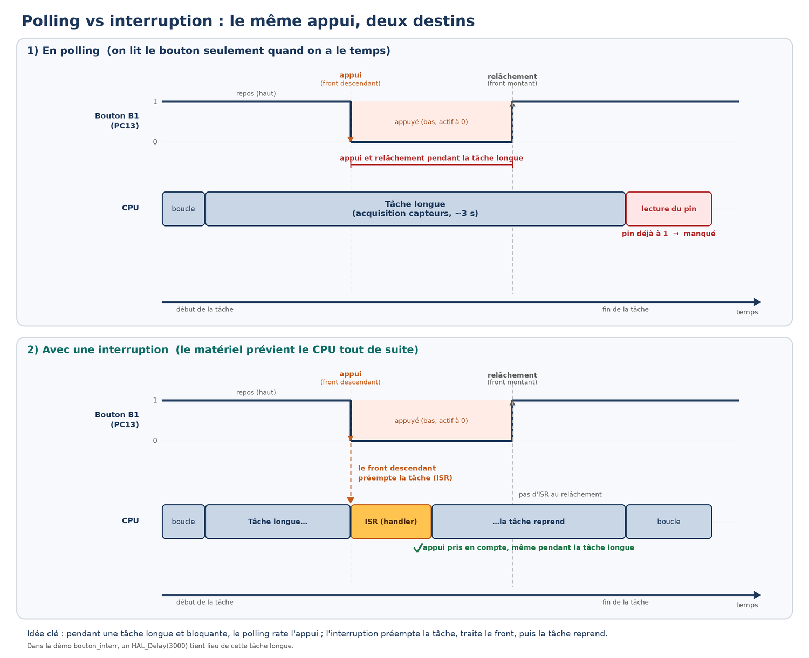

L'idée, c'est une **tâche longue et bloquante** — typiquement une acquisition de capteurs qui dure quelques secondes. Dans le projet `bouton_interr`, un `HAL_Delay(3000)` en tient lieu, puis on bascule la LED. Sans interruption, on lit le bouton *après* cette tâche. Si on a appuyé puis relâché pendant ce temps, c'est trop tard.

```c
while (1) {
	HAL_Delay(3000); // simulation d'une tache longe, l'appui du bouton est rarement détecté
	HAL_GPIO_TogglePin(LD2_GPIO_Port, LD2_Pin);

#ifndef MODE_INTERRUPTION
	GPIO_PinState etat_bouton = HAL_GPIO_ReadPin(B1_GPIO_Port, B1_Pin);
	if (etat_bouton == GPIO_PIN_RESET) // si le bouton est appuyé
		printf("Le bouton est appuyé %lu fois\n", compteur++);
#endif
}
```

> [!NOTE]
> Dans ce code, un appui correspond à `GPIO_PIN_RESET` (le pin passe à 0). C'est pour ça que l'interruption sera configurée sur un **front descendant** (falling edge).

Avec l'interruption, le même appui **préempte** la tâche longue : le **handler** (la routine d'interruption, ISR : Interrupt Service Routine) s'exécute tout de suite, puis la tâche reprend exactement où elle en était.


## Code complet interruption

```c
#include <stdio.h>
#include "board.h"
#include "stm32l4xx_hal.h"
#include "pins.h"

#define MODE_INTERRUPTION

uint32_t compteur = 0;

int main(void) {

    board_init();
    printf("Hello crazy world!\n");

    while(1) {
        HAL_Delay(3000); // simulation d'une tache longe, l'appui du bouton est rarement détecté
        HAL_GPIO_TogglePin(LD2_GPIO_Port, LD2_Pin);
        
        #ifndef MODE_INTERRUPTION
        GPIO_PinState etat_bouton = HAL_GPIO_ReadPin(B1_GPIO_Port, B1_Pin);
        if(etat_bouton == GPIO_PIN_RESET) // si le bouton est appuyé
            printf("Le bouton est appuyé %lu fois\n", compteur++);
        #endif
    }
}

void EXTI15_10_IRQHandler(void)
{
  HAL_GPIO_EXTI_IRQHandler(B1_Pin);
}


// Avec les interruptions on arrive à réagir face à des évenements asynchrones 
#ifdef MODE_INTERRUPTION
void HAL_GPIO_EXTI_Callback(uint16_t GPIO_Pin) {
    if (GPIO_Pin == B1_Pin)
        printf("Le bouton est appuyé %u fois\n", compteur++);
}
#endif
```


## La chaîne : GPIO, EXTI, NVIC, CPU

Un appui sur `PC13` ne saute pas tout seul dans notre fonction C. Il traverse quatre étages :

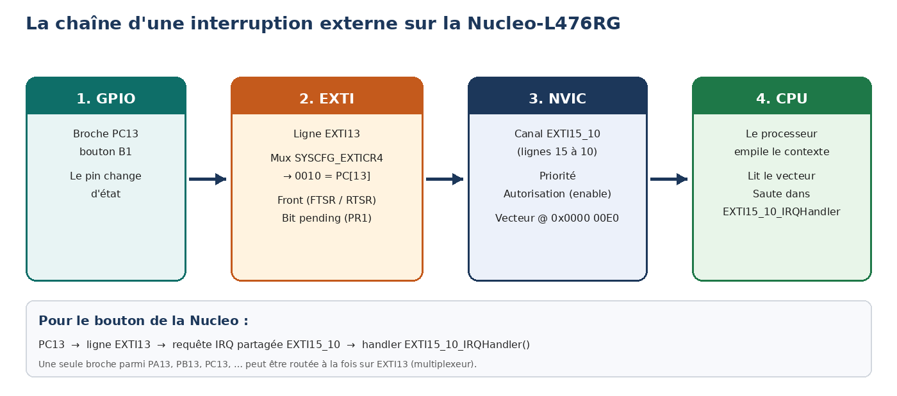

1. **GPIO** — la broche `PC13` change d'état.
2. **EXTI** (Extended interrupts and events controller) — un contrôleur qui surveille des *lignes* d'interruption. La broche est routée vers la ligne `EXTI13`, on choisit le front, et un bit **pending** (en attente) est levé.
3. **NVIC** (Nested Vectored Interrupt Controller) — le contrôleur d'interruptions du Cortex-M4. Il décide si la requête est autorisée, à quelle **priorité**, et quelle adresse de handler aller chercher dans la **table des vecteurs**.
4. **CPU** — le processeur empile son contexte (les registres), saute dans le handler, puis dépiler pour reprendre le programme interrompu.

> [!IMPORTANT]
> Dans le prosit interruptions, on te demande d'identifier le rôle du GPIO, du contrôleur EXTI et du NVIC. Cette chaîne est le décor : à toi de la reformuler avec tes mots, en la reliant au problème de la tâche longue et de l'appui sur le bouton. On ne rédige pas le livrable ici.

## L'EXTI sur le STM32L476

### De PC13 vers la ligne EXTI13

Les GPIOs du STM32L476 sont branchés sur **16 lignes configurables**, `EXTI0` à `EXTI15` (une ligne par *numéro* de broche, pas par port).

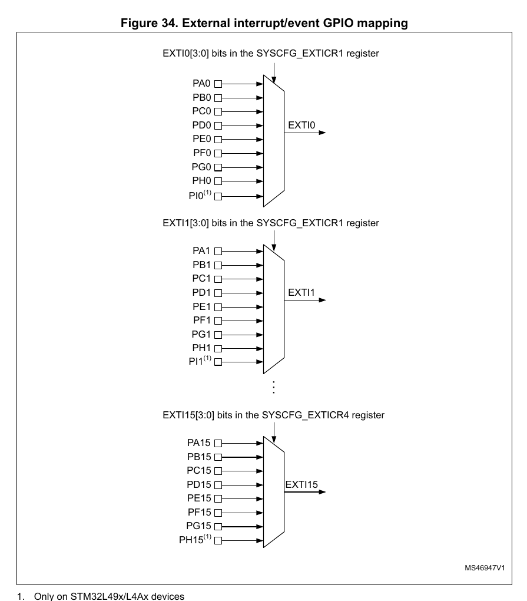

*Source : RM0351 Rev 11, p. 402, Figure 34.*

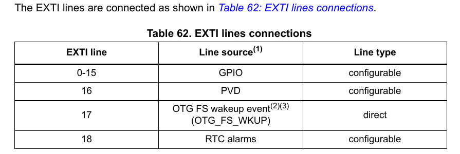

*Source : RM0351 Rev 11, p. 402, Table 62 (extrait : lignes 0–18).*

Le détail important : `PA13`, `PB13`, `PC13`, `PD13`, … arrivent **toutes** sur la même ligne `EXTI13`. Un **multiplexeur** (mux) choisit *quelle* broche est écoutée. Ce choix se programme dans les registres `SYSCFG_EXTICRx`.

Pour `EXTI13`, c'est le champ `EXTI13[3:0]` de `SYSCFG_EXTICR4` (bits 7 à 4). Pour brancher `PC13`, on écrit `0010` :

![SYSCFG_EXTICR4 — le champ EXTI13, avec 0010 = PC[13]](./images/rm0351_syscfg_exticr4.png)

*Source : RM0351 Rev 11, p. 323, § 9.2.6 (SYSCFG_EXTICR4). L'extrait saute les champs EXTI15 et EXTI14 pour aller directement à EXTI13.*

> [!NOTE]
> Une seule broche à la fois sur `EXTI13`. Si on route `PC13`, `PA13` n'arrivera plus jusqu'à cette ligne.

### Le front et le bit pending

Le schéma bloc de l'EXTI (lignes configurables) montre les registres qu'on va manipuler, souvent sans le voir : HAL s'en charge, mais ça reste le matériel en dessous.

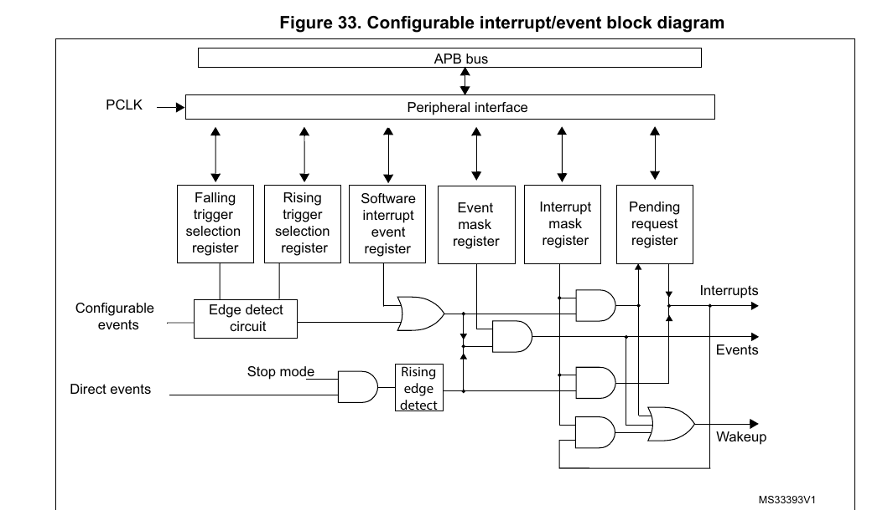

*Source : RM0351 Rev 11, p. 400, Figure 33, § 14.3.1.*

Pour qu'un front sur `EXTI13` devienne une interruption, le manuel donne trois étapes (§ 14.3.4) :

1. démasquer la ligne dans `EXTI_IMR` (interrupt mask : `1` = la requête n'est *pas* masquée) ;
2. choisir le front dans `EXTI_RTSR` (rising) et/ou `EXTI_FTSR` (falling) ;
3. autoriser le canal correspondant dans le **NVIC**.

Dans la démo, on veut un **front descendant**. C'est le bit `FT13` de `EXTI_FTSR1` :

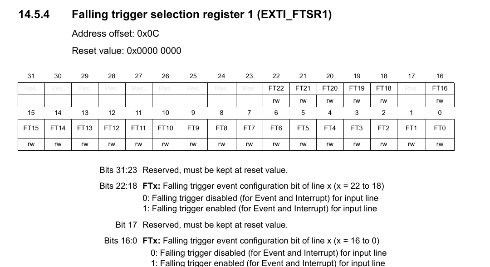

*Source : RM0351 Rev 11, p. 405, § 14.5.4 (EXTI_FTSR1).*

Quand le front arrive, le bit **pending** `PIF13` passe à `1` dans `EXTI_PR1`. C'est ce drapeau matériel qui dit « un événement s'est produit sur cette ligne ».

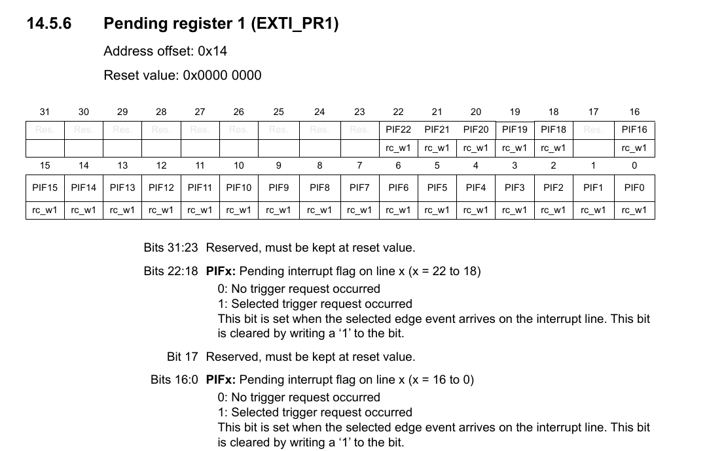

*Source : RM0351 Rev 11, p. 407, § 14.5.6 (EXTI_PR1).*

> [!IMPORTANT]
> Le bit pending s'**efface en y écrivant `1`** (`rc_w1` : read/clear by writing 1). Si on l'oublie, le NVIC revoit tout de suite la même requête, et le handler tourne en boucle.

> [!NOTE]
> On peut autoriser les deux fronts sur la même ligne. Dans ce cas, une montée *et* une descente déclenchent chacune une requête (RM0351, p. 405).

## Le NVIC et la table des vecteurs

Les lignes `EXTI10` à `EXTI15` ne sont pas chacune un handler séparé : elles partagent **un seul** vecteur, `EXTI15_10`. Dans la table du STM32L476, c'est la **position 40**, à l'adresse `0x0000 00E0` :

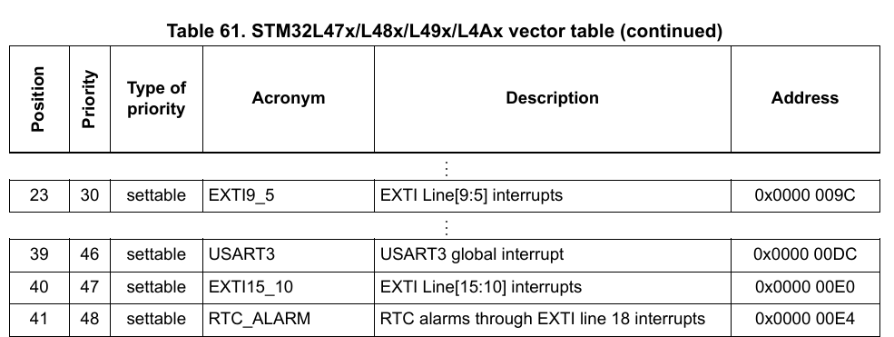

*Source : RM0351 Rev 11, p. 396, Table 61 (extrait : on garde aussi `EXTI9_5`, l'autre vecteur groupé, pour comparaison).*

Cette « position 40 » est le **numéro d'IRQ** (`EXTI15_10_IRQn`). Le manuel du Cortex-M4 montre comment la table est rangée : d'abord la valeur initiale de la pile, puis Reset, NMI, etc., puis les IRQ à partir du numéro 0 (offset `0x00000040`). Notre IRQ 40 se trouve donc bien à `0x40 + 40×4 = 0x000000E0`.

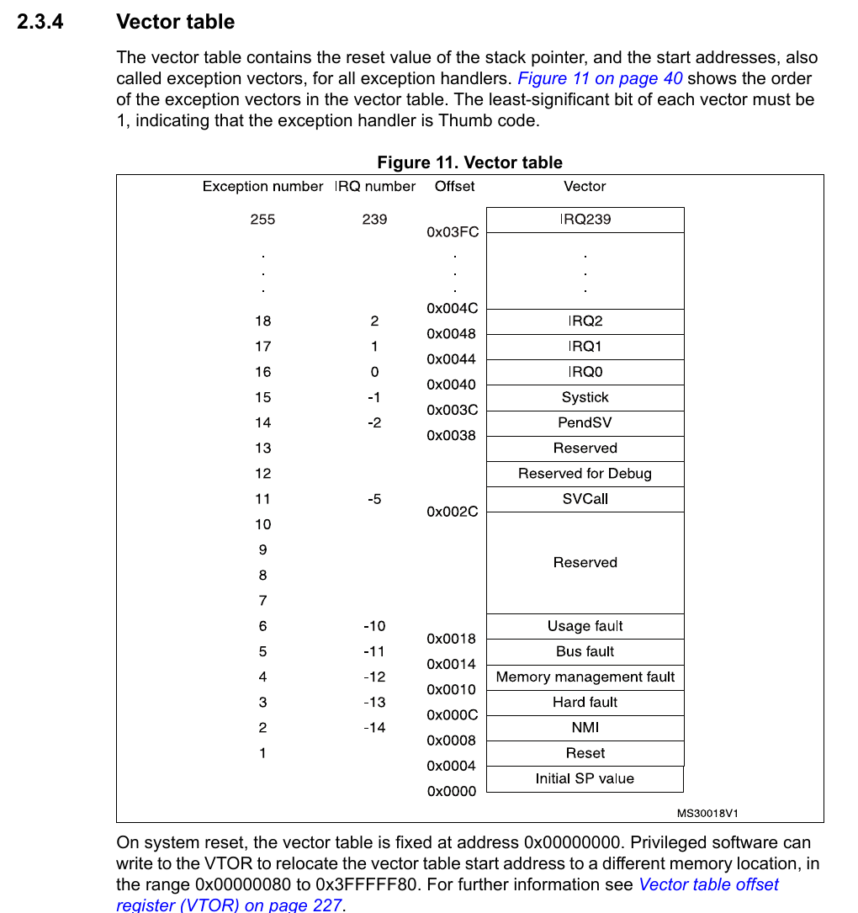

*Source : PM0214 Rev 10, p. 40, Figure 11 et § 2.3.4.*

Le NVIC ne se contente pas d'un on/off. Chaque IRQ a une **priorité**. Attention au sens : **plus la valeur est petite, plus la priorité est haute**. `0` est donc la priorité la plus urgente parmi les interruptions configurables (PM0214, § 2.3.5 et § 4.3).

Les champs de priorité tiennent sur 8 bits dans le registre, mais le processeur n'utilise que les bits `[7:4]` : ça fait 16 niveaux, de 0 à 15.

![Figure 19 et Table 47 — Champs de priorité du NVIC, bits [7:4] uniquement](./images/pm0214_fig19_nvic_ipr.png)

*Source : PM0214 Rev 10, p. 215, Figure 19 et Table 47.*

Quand le NVIC accepte la requête, le CPU **empile** automatiquement quelques registres (`R0–R3`, `R12`, `LR`, `PC`, `xPSR` — plus les registres flottants si besoin), et **en parallèle** il lit l'adresse du handler dans la table (le *vector fetch*). Au retour, il dépile, et le programme interrompu reprend.

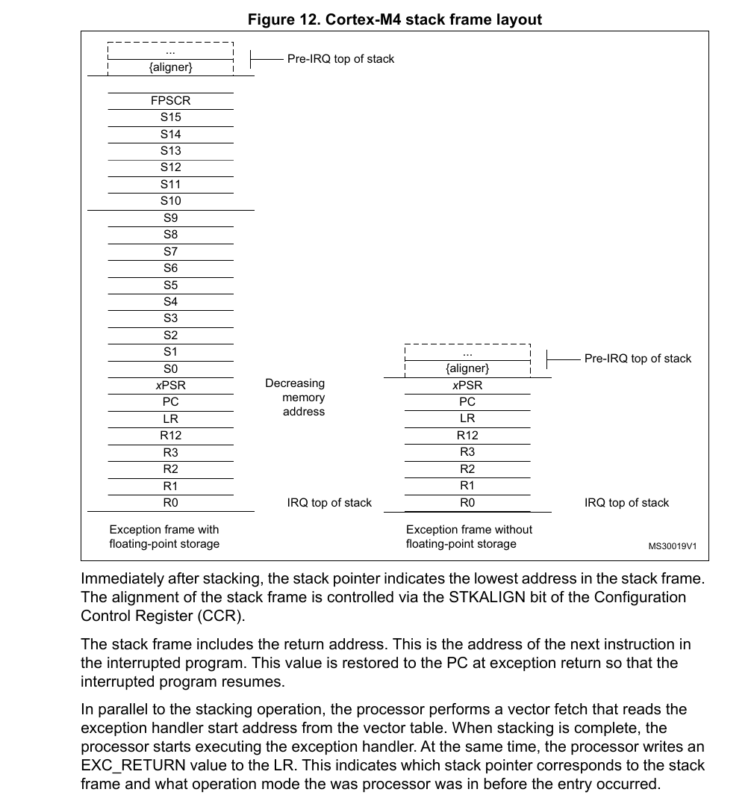

*Source : PM0214 Rev 10, p. 43, Figure 12 et le texte qui suit (stacking + vector fetch).*

En pratique, on ne tape pas dans `NVIC_ISERx` à la main. HAL s'appuie sur CMSIS :

```c
HAL_NVIC_SetPriority(EXTI15_10_IRQn, 0, 0); // priorité 0, sous-priorité 0
HAL_NVIC_EnableIRQ(EXTI15_10_IRQn);
```

`HAL_NVIC_EnableIRQ` appelle directement `NVIC_EnableIRQ` (CMSIS). `HAL_NVIC_SetPriority(IRQn, preempt, sub)` fait un peu plus : il lit le groupement de priorités en cours (`NVIC_GetPriorityGrouping`), encode la préemption et la sous-priorité avec `NVIC_EncodePriority`, puis passe le résultat à `NVIC_SetPriority`.

> [!NOTE]
> `HAL_Init` choisit `NVIC_PRIORITYGROUP_4` : les 4 bits de priorité vont tous à la préemption, la sous-priorité ne compte plus. Dans l'appel `(EXTI15_10_IRQn, 0, 0)`, seul le premier `0` (préemption, de 0 à 15) a un effet ; le second est effectivement ignoré.

C'est exactement ce que fait `MX_GPIO_Init` dans `bouton_interr`.

## Le code HAL, pas à pas

Voici le chemin complet, tel qu'il est câblé dans le projet `bouton_interr`.

### La configuration

`B1` est `PC13`. On le met en entrée *interruptible*, front descendant, puis on arme le NVIC :

```c
/* Configure GPIO pin : B1_Pin */
GPIO_InitStruct.Pin = B1_Pin;
GPIO_InitStruct.Mode = GPIO_MODE_IT_FALLING;
GPIO_InitStruct.Pull = GPIO_NOPULL;
HAL_GPIO_Init(B1_GPIO_Port, &GPIO_InitStruct);

/* EXTI interrupt init */
HAL_NVIC_SetPriority(EXTI15_10_IRQn, 0, 0);
HAL_NVIC_EnableIRQ(EXTI15_10_IRQn);
```

`GPIO_MODE_IT_FALLING`, c'est HAL qui, derrière, programme le mux `SYSCFG_EXTICR4`, le masque `EXTI_IMR`, et le front `EXTI_FTSR`. Les deux appels `HAL_NVIC_*` font l'étape 3 du manuel.

### Du vecteur jusqu'au callback

Quand `PIF13` se lève et que le NVIC laisse passer, le CPU saute à `EXTI15_10_IRQHandler`. Dans la démo, ce handler se contente d'appeler HAL, qui va regarder le bit pending de `B1`, l'effacer, puis appeler un **callback** (une fonction que *nous* remplissons) :

```c
void EXTI15_10_IRQHandler(void)
{
	HAL_GPIO_EXTI_IRQHandler(B1_Pin);
}

void HAL_GPIO_EXTI_Callback(uint16_t GPIO_Pin)
{
	if (GPIO_Pin == B1_Pin)
		printf("Le bouton est appuyé %u fois\n", compteur++);
}
```

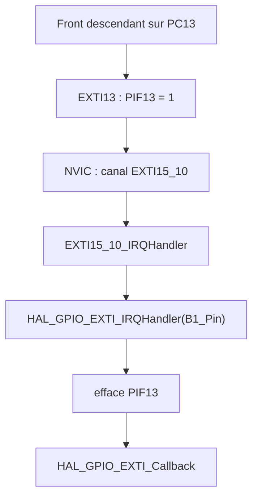

> [!IMPORTANT]
> Le `printf` dans le callback de la démo est pratique pour *voir* que ça marche, mais ce n'est pas une bonne pratique : `printf` peut être lent, et il n'est en général pas conçu pour être appelé depuis une interruption. Ce n'est pas une règle du matériel, juste une habitude à prendre. Mieux vaut poser un **drapeau** `volatile` et traiter l'événement dans la boucle principale.
>
> L'exemple officiel ST (GPIO_EXTI sur Nucleo-L476RG) prévient aussi qu'un `HAL_Delay` dans une ISR bloque le système, sauf si `SysTick` a une priorité **plus haute** que l'interruption en cours : `HAL_Delay` attend que le tick avance, et si on est déjà dans une ISR plus prioritaire que SysTick, le tick ne passe plus.

```c
volatile uint8_t bouton_appuye = 0;

void HAL_GPIO_EXTI_Callback(uint16_t GPIO_Pin)
{
	if (GPIO_Pin == B1_Pin)
		bouton_appuye = 1;
}

/* dans le while(1), à côté de la tâche longue : */
if (bouton_appuye) {
	bouton_appuye = 0;
	/* traiter l'appui ici, pas dans l'ISR */
}
```

On met `volatile` parce que le flag est écrit dans l'interruption et lu dans `main`. Sans ça, le compilateur pourrait croire que `bouton_appuye` ne change jamais dans la boucle, et « optimiser » la lecture.

> [!NOTE]
> **Rebonds (debounce).** Un bouton mécanique ne passe pas proprement de 1 à 0 : il peut produire plusieurs fronts pour un seul appui, donc plusieurs interruptions. Une fenêtre typique — ce n'est pas une spécification ST — est de quelques millisecondes. Une ISR courte qui se contente de lever un flag, puis un traitement dans `main`, est déjà un bon cadre pour s'en occuper (par exemple en ignorant un nouvel appui trop rapproché). On ne pousse pas plus loin ici : mesurer la *durée* d'un appui, c'est un autre problème, à toi de le poser proprement dans le cadre du prosit.

## Pour retenir

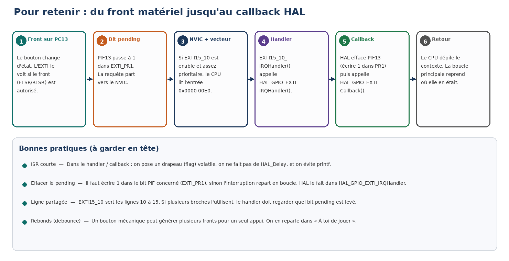

En une phrase : **GPIO** (le pin) → **EXTI** (ligne, front, bit pending) → **NVIC** (autorisation, priorité, vecteur) → **CPU** (handler, puis callback HAL) → on efface le pending et on rend la main.

## À toi de jouer

Pas de corrigé ici, juste de quoi pratiquer sur la Nucleo, sans faire le livrable du prosit à ta place.

1. **La LED à la place du `printf`.** Dans `HAL_GPIO_EXTI_Callback`, à la place de l'affichage, bascule `LD2` (`PA5`) avec `HAL_GPIO_TogglePin`. Tu devrais voir la LED changer *pendant* le `HAL_Delay(3000)`, pas seulement à la fin.
2. **Le drapeau `volatile`.** Remplace le travail fait dans le callback par le schéma `bouton_appuye` ci-dessus, et fais le `TogglePin` (ou le `printf`) dans le `while(1)`. Vérifie que les appuis pendant le délai sont toujours vus, et que la boucle principale reste le seul endroit « bavard ».
3. **Une ligne, plusieurs broches.** `EXTI15_10` sert les lignes 10 à 15. Si demain une *autre* broche de ce groupe (par exemple une `PAx` avec `x` entre 10 et 15) devait aussi interrompre : que faut-il ajouter dans `EXTI15_10_IRQHandler` ? Que se passe-t-il si on n'efface que le pending de `B1` ?

## Sources

Les manuels utilisés pour cette séance sont déjà dans `cours/adriana/docs/` :

- RM0351 Rev 11 — *STM32L47xxx / L48xxx / L49xxx / L4Axxx reference manual* (EXTI ch. 14, SYSCFG § 9.2, table des vecteurs Table 61)
- PM0214 Rev 10 — *STM32 Cortex-M4 programming manual* (table des vecteurs, entrée d'exception, NVIC)

Code HAL et exemple ST :

- [`stm32l4xx_hal_gpio.c`](https://github.com/STMicroelectronics/stm32l4xx-hal-driver/blob/master/Src/stm32l4xx_hal_gpio.c)
- [`stm32l4xx_hal_cortex.c`](https://github.com/STMicroelectronics/stm32l4xx-hal-driver/blob/master/Src/stm32l4xx_hal_cortex.c)
- [Exemple GPIO_EXTI (NUCLEO-L476RG)](https://github.com/STMicroelectronics/STM32CubeL4/blob/master/Projects/NUCLEO-L476RG/Examples/GPIO/GPIO_EXTI/Src/main.c)
